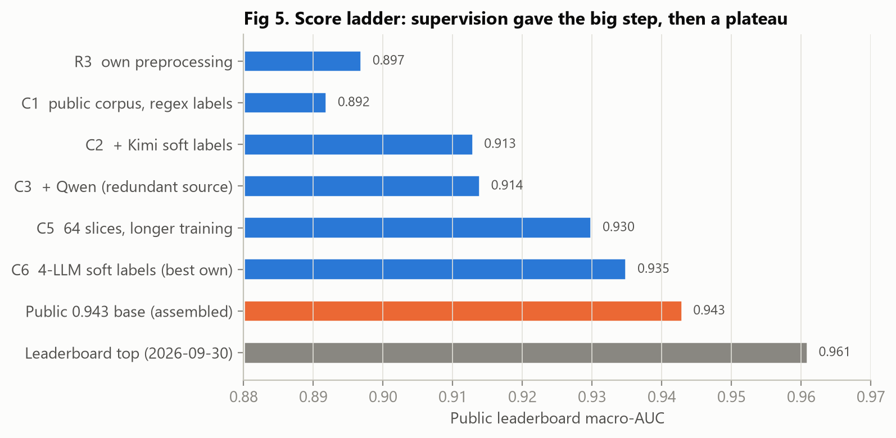
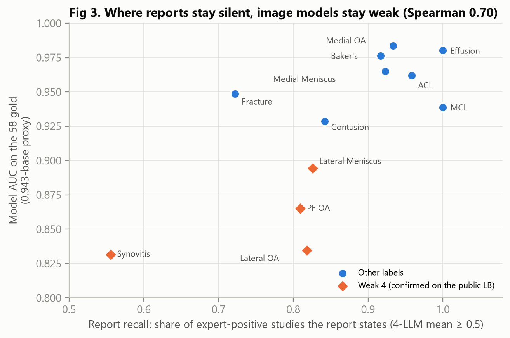
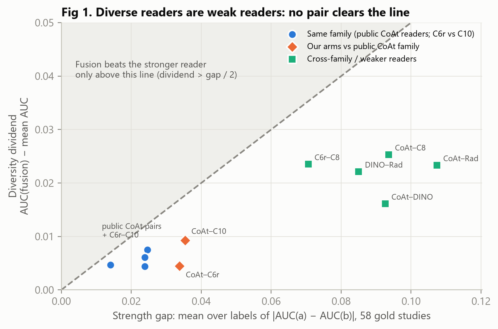
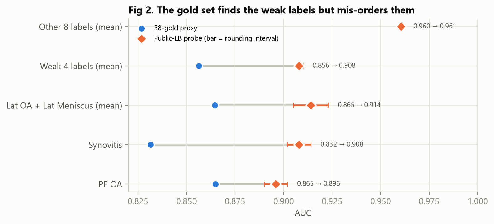
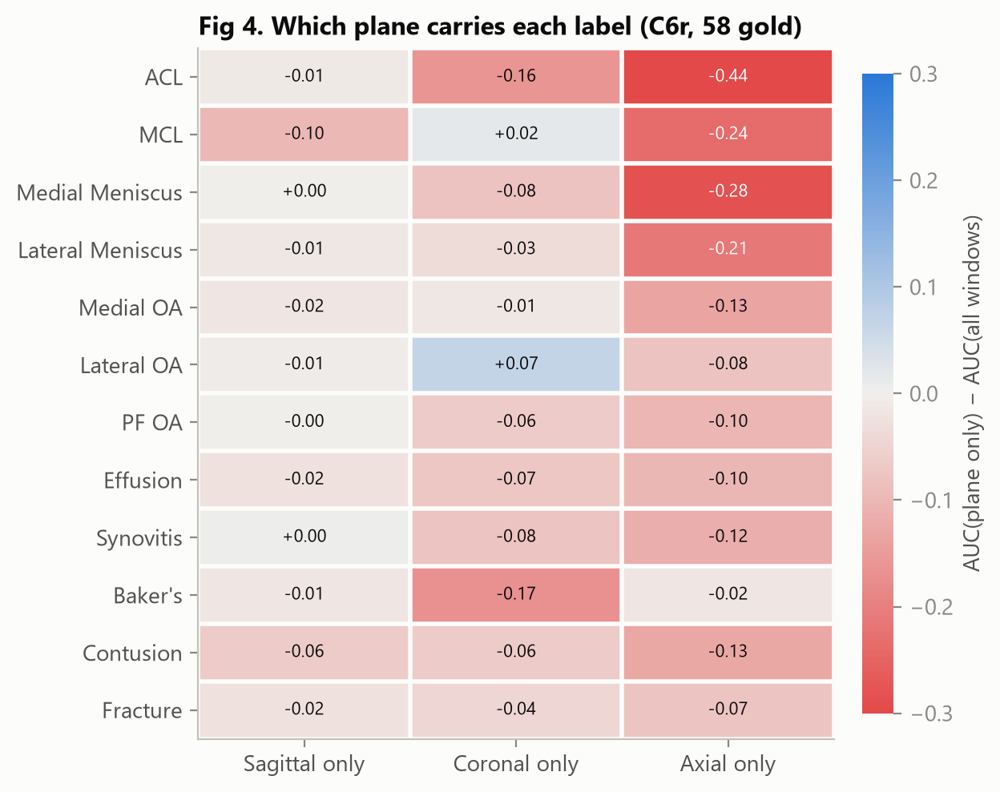
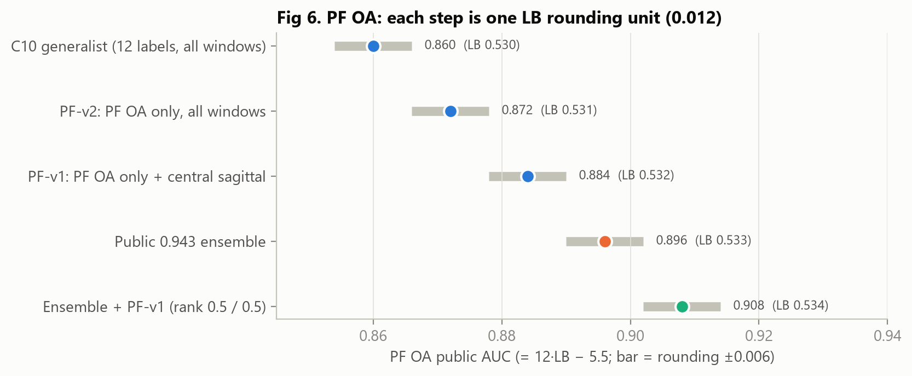

# 用稀少的专家标签和放射报告学习膝关节 MRI 异常检测
# Learning Knee MRI Abnormalities from Sparse Expert Labels and Radiology Reports

> **读者 / Audience**：学过机器学习基础、想了解一个真实医学影像项目怎么做研究的学生。
> Students with basic ML background who want to see how research is done on a real medical-imaging project.
>
> **状态 / Status**：初稿（2026-10-01），2026-10-03 补入第 8 节（PF OA 专科化）和第 5 节末尾的修正（C10 单模）。
> Draft (2026-10-01); Section 8 (PF OA specialisation) and a correction at the end of Section 5 (C10 alone) added 2026-10-03.
>
> 所有数字都能追溯到 `LOG.md` 条目或 `results/` 下的文件。
> Every number traces back to a `LOG.md` entry or a file under `results/`.

---

## 目录 / Contents

1. 任务与数据 / Task and data
2. 先弄懂几个概念 / Concepts you need first
3. 分数阶梯：我们做到了哪里 / The score ladder
4. 发现一：报告漏报决定弱监督的天花板（RQ1）/ Finding 1: report omissions cap weak supervision
5. 发现二：强读者殊途同归，多样性只来自弱读者（RQ3）/ Finding 2: strong readers converge
6. 发现三：58 个金标能找到弱项，但排不对顺序 / Finding 3: 58 gold labels find the weak spots but mis-order them
7. 发现四：模型看哪个平面、怎么汇总（RQ2）/ Finding 4: which plane, which pooling (RQ2)
8. 发现五：把容量集中到一个弱标签（PF OA）/ Finding 5: specialising on one weak label (PF OA)
9. 给学生的方法论教训 / Methodological lessons
10. 局限 / Limitations
11. 如何复现 / How to reproduce

---

## 1. 任务与数据 / Task and data

**中文**

RSNA Knee Abnormality Detection 是一个 Kaggle 代码竞赛：给定一次膝关节 MRI 检查（一个 *study*，包含矢状、冠状、轴位等多个序列），预测 12 种异常各自的概率，包括前交叉韧带（ACL）、内侧副韧带（MCL）、内外侧半月板、三个关节间室的骨关节炎（OA）、积液、滑膜炎、腘窝囊肿（Baker's）、骨挫伤和骨折。

数据有三个特点，决定了整个项目的走向：

- **专家标签极少**：训练集 4,407 个 study 中，只有 **58 个**有专家逐项标注。
- **其余只有放射报告**：报告是医生写的自由文本，多语种，没有结构化标签。报告**只在训练集里有**，测试时只给影像。
- **推理受限**：代码竞赛，推理在断网的 Notebook 里完成，总时限 9 小时。

所以核心问题是：**怎样用报告（训练时才有）去教一个只看影像的模型？** 这在文献里叫"特权信息"（privileged information），也是一种弱监督（weak supervision）。

**English**

RSNA Knee Abnormality Detection is a Kaggle code competition. Given one knee MRI examination (a *study* with sagittal, coronal and axial series), predict a probability for each of 12 abnormalities: ACL, MCL, medial and lateral meniscus, osteoarthritis (OA) in three compartments, effusion, synovitis, Baker's cyst, bone contusion and fracture.

Three properties of the data shape the whole project:

- **Very few expert labels**: of 4,407 training studies, only **58** have expert labels.
- **Everything else has only a report**: free-text, multilingual radiology reports. Reports exist **only at training time**; the test set gives images only.
- **Constrained inference**: offline notebooks, 9-hour limit.

So the central question is: **how do you use reports (available only during training) to teach an image-only model?** The literature calls this *privileged information*, a form of weak supervision.

---

## 2. 先弄懂几个概念 / Concepts you need first

| 概念 / Concept | 中文解释 | English |
|---|---|---|
| **AUC** | 随机挑一个阳性和一个阴性，模型把阳性排在前面的概率。只看**排序**，不看概率是否校准。 | Probability that a random positive is ranked above a random negative. Depends only on **ordering**, not calibration. |
| **Macro-AUC** | 12 个标签各算一个 AUC 再取平均。罕见标签和常见标签**权重相同**。 | Mean of the 12 per-label AUCs. A rare label counts **as much** as a common one. |
| **软标签 / Soft label** | 用正则或大语言模型（LLM）读报告，给每个异常一个 0–1 的概率，作为训练目标。 | A 0–1 target per abnormality, extracted from the report by regex or an LLM. |
| **MIL（多示例学习）** | 一个 study 是一"袋"图像窗口（3 张相邻切片叠成一张 RGB 图）。标签属于整袋，不属于某张图。 | A study is a *bag* of image windows (3 adjacent slices as RGB); the label belongs to the bag, not to any window. |
| **注意力池化 / Attention pooling** | 每个异常学一套权重，决定袋里哪些窗口更重要，再加权平均。 | Per-abnormality learned weights over the bag's windows, then a weighted average. |
| **秩融合 / Rank fusion** | 把几个模型的预测各自换成百分位秩再加权平均。AUC 只看排序，所以这样不会被某个模型的概率尺度主导。 | Average the models' percentile ranks. Since AUC only reads order, no model's probability scale dominates. |
| **公榜 / 私榜** | Kaggle 的测试集分两部分：公榜分数比赛期间可见，私榜分数赛后才公布，最终排名按私榜。 | The test set is split: the public score is visible during the competition; the private score decides the final ranking. |
| **噪声下限 / Noise floor** | 同一配置换随机种子，公榜分数会波动约 ±0.004。**小于这个的差别不能当作结论。** | Re-running the same config with another seed moves the public score by about ±0.004. **Differences below that are not findings.** |
| **预注册 / Pre-registration** | 实验之前就把判据写下来（例如"≥ 0.937 才算有效"），出分后不改。 | Write the decision rule before the result (e.g. "effective only if ≥ 0.937") and never change it afterwards. |

---

## 3. 分数阶梯：我们做到了哪里 / The score ladder



**图 5 / Fig 5**：项目里程碑的公榜分数。蓝色是我们自己的模型，橙色是复现的公开方案，灰色是榜首。
Public-leaderboard scores of the milestones. Blue: our own models; orange: the assembled public solution; gray: the leaderboard top.

| 版本 / Version | 改了什么 / What changed | 公榜 / Public LB |
|---|---|---:|
| R3 | 自研预处理 + CoAtNet MIL / own preprocessing + CoAtNet MIL | 0.897 |
| C1 | 公开预解码语料，正则标签 / public pre-decoded corpus, regex labels | 0.892 |
| C2 | **+ Kimi LLM 软标签** / **+ Kimi LLM soft labels** | **0.913** |
| C3 | + Qwen（与 Kimi 高度相关）/ + Qwen (highly correlated with Kimi) | 0.914 |
| C5 | 64 片 + 更长训练（多变量）/ 64 slices + longer training (multi-variable) | 0.930 |
| C6 | 四个 LLM 软标签：自研最好 / four-LLM soft labels: best own model | **0.935** |
| 公开基底 / Public base | 多个公开模型的装配 / assembly of several public models | 0.943 |
| 榜首 / Leaderboard top | — | 0.961 |

**中文**

- **最大的一步来自监督信号**：只把训练标签从正则换成"正则 + 一个 LLM"，分数就从 0.892 涨到 0.913（+0.021）。相比之下，换掉整条预处理管线几乎不动分（R3 → C1）。
- **之后进入平台期**：再加更多 LLM、换标签组合、加权、蒸馏、换骨干、做集成……约二十次干净的单变量实验，全部落在 ±0.004 的噪声里。
- 后面三节讲的是**为什么**会这样。

**English**

- **The biggest step came from supervision**: changing only the training labels from regex to "regex + one LLM" moved the score from 0.892 to 0.913 (+0.021). Replacing the whole preprocessing pipeline barely moved it (R3 → C1).
- **Then a plateau**: more LLMs, other label mixes, confidence weighting, distillation, new backbones, ensembles — about twenty clean single-variable experiments, all inside the ±0.004 noise band.
- The next three sections are about **why**.

---

## 4. 发现一：报告漏报决定弱监督的天花板（RQ1）/ Finding 1: report omissions cap weak supervision

**中文**

我们在 58 个金标上逐个标签检查：**专家判为阳性的病例里，报告到底写了多少？** 判定方法是 4 个 LLM 读报告后的平均概率 ≥ 0.5。



**图 3**：横轴是报告对专家阳性的召回率，纵轴是模型在金标上的 AUC。橙色菱形是公榜按标签探测确认的 4 个弱标签（见第 6 节）。

| 标签 | 报告召回 | 专家阴性里报告写了阳性 | 报告目标 AUC | 模型 AUC |
|---|---:|---:|---:|---:|
| Synovitis 滑膜炎 | **0.56** | 0.16 | 0.763 | 0.832 |
| Fracture 骨折 | 0.72 | 0.13 | 0.853 | 0.949 |
| PF OA 髌股关节炎 | 0.81 | 0.16 | **0.912** | 0.865 |
| Lateral OA 外侧关节炎 | 0.82 | 0.17 | 0.851 | 0.835 |
| Lateral Meniscus 外侧半月板 | 0.83 | 0.11 | 0.887 | 0.894 |
| Effusion 积液 | 1.00 | **0.70** | 0.866 | 0.980 |
| 其余 6 个 | 0.84–1.00 | 0.11–0.33 | 0.846–0.990 | 0.928–0.984 |

报告作为监督信号，会以**两种不同的方式**出错：

1. **漏报**：专家标了阳性，报告却没写。滑膜炎最严重：专家阳性里只有 56% 被报告写出来。
2. **阈值不一致**：报告写了，专家却不算阳性。积液最典型：70% 的专家阴性，报告里都写了积液。进一步分析发现，被专家判为阴性的多是"少量 / 生理性"积液。

关键结果：**在 12 个标签上，报告召回率与模型 AUC 的秩相关为 0.70**。这比"报告目标本身的 AUC"更能预测模型在哪里弱（后者只有 0.56）。原因有两点：

- 阈值问题图像能补回来。积液在影像上看得见，所以模型 AUC（0.980）远高于报告目标（0.866）。
- 漏报补不回来。报告没写的东西，模型从标签里学不到。

**这也解释了一个让我们困惑很久的现象**：有两次实验（换一组 LLM、加图像老师蒸馏），训练标签在金标上明显变好了，公榜却纹丝不动。因为它们改进的是**"读懂报告"**，而改变不了**"报告本身没写"**。

**English**

On the 58 gold studies we asked, label by label: **of the studies an expert called positive, how many does the report actually state?** A report counts as stating it when the mean of 4 LLMs reading it is ≥ 0.5.

**Fig 3**: x = report recall on expert positives; y = model AUC on the gold set. Orange diamonds are the 4 weak labels confirmed by public-leaderboard probing (Section 6). The table above lists the numbers.

Reports fail as supervision in **two distinct ways**:

1. **Omission**: the expert marks it, the report never says it. Synovitis is worst: only 56% of expert positives are stated.
2. **Threshold mismatch**: the report says it, the expert does not count it. Effusion is the example: 70% of expert negatives mention an effusion, mostly small or physiological ones.

Key result: **across the 12 labels, report recall correlates with model AUC at Spearman 0.70**, a better predictor than the report target's own AUC (0.56). Two reasons:

- Threshold problems can be fixed by the image: effusion is visible, so the model (0.980) beats its own target (0.866).
- Omissions cannot: what the report never says, the model cannot learn from the label.

**This also explains a puzzle**: twice (a different LLM mix, and image-teacher distillation), the training labels got clearly better on the gold set but the public score did not move. Both improved **reading** the report; neither can change what the report **never wrote**.

---

## 5. 发现二：强读者殊途同归，多样性只来自弱读者（RQ3）/ Finding 2: strong readers converge; diversity comes only from weak readers

**中文**

集成学习的常识是"把不同的模型合起来会更好"。我们把自己的模型融进公开基底试了 7 次，**没有一次超出噪声**。为了找原因，我们在金标上测量了 11 对模型（称为"读者"）之间的相关性和融合收益。



**图 1**：横轴是两个读者的**逐标签平均** AUC 差距，纵轴是"多样性红利"，即等权融合的 AUC 比两者平均高出多少。只有点落在虚线上方，融合才能超过较强的那个。

逐标签看，有一个恒等式：

```
融合 − 较强者 = 红利 − |差距| / 2
fusion − stronger = dividend − |gap| / 2
```

所以融合要有收益，红利必须大于差距的一半。

| 读者对 / Reader pair | 类内相关 / Within-class ρ | 红利 / Dividend | 融合 − 较强 / Fusion − stronger |
|---|---:|---:|---:|
| 公开 CoAt 读者两两之间 / public CoAt readers | 0.81–0.87 | +0.005 ~ +0.008 | −0.002 ~ −0.006 |
| 公开 CoAt vs 我们的 C6r / C10 | 0.81 / 0.83 | +0.004 / +0.009 | −0.012 / −0.008 |
| 公开 CoAt vs 弱读者（C8、Rad、DINO） | 0.52–0.75 | **+0.016 ~ +0.025** | −0.022 ~ −0.030 |

"类内相关"只在专家阳性内、阴性内分别计算，用来排除"两个模型都判对了所以一致"的那部分。

**中文要点**

- **我们的模型只是"第 5 个同类读者"**：C6r（CoAtNet）和 C10（ConvNeXt）与公开 CoAt 读者的相关性，和公开读者彼此之间一样高。**换架构也不能让它变得独立**。
- **多样性和弱是绑在一起的**：真正与众不同的读者，比强读者弱约 0.09–0.11。它们带来的红利（最多 +0.025）不到差距的一半。
- **一个反直觉的细节**：DINO 和 Rad 的宏平均 AUC 几乎一样（差 0.014），但逐标签差 0.085，因为它们各强一边。这种组合适合**按标签加权**，不适合等权融合。公开基底给每个标签单独设外层权重，正是这样做的。

**English points**

- **Our models are just a fifth reader of the same family**: C6r (CoAtNet) and C10 (ConvNeXt) correlate with the public CoAt readers as strongly as those readers correlate with each other. **Changing the architecture did not make them independent.**
- **Diversity comes bundled with weakness**: the truly different readers are about 0.09–0.11 weaker, and their dividend (at most +0.025) is less than half that gap.
- **A counter-intuitive detail**: DINO and Rad have almost the same macro-AUC (0.014 apart) but differ by 0.085 per label, because each is strong on different labels. Such pairs call for **per-label weighting**, not equal-weight fusion. The public base's per-label outer weights do exactly that.

**按标签加权能补救多少？/ How much can per-label weighting recover?**

我们把 58 例对半分，在一半上为每个标签挑权重，在另一半上评估，重复 200 次（"交叉验证"）。
We split the 58 studies in half, picked per-label weights on one half and scored them on the other, 200 times ("cross-validation").

| 读者对 / Pair | 等权 / Equal | 较强者单独 / Stronger alone | 按标签加权 / Per-label (CV) | 在评估集上调 / Tuned on eval |
|---|---:|---:|---:|---:|
| DINO + Rad（两弱、各强一边 / two weak, complementary） | 0.854 | 0.830 | **0.865** | 0.884 |
| CoAt + 弱读者 / CoAt + a weak reader | 0.902–0.912 | **0.932–0.933** | 0.924 | 0.935–0.940 |

- 按标签加权**能**兑现两个弱读者之间的互补：比较强者高 0.035。
  Per-label weighting **does** cash in the complementarity of two weak readers: +0.035 over the stronger one.
- 但它**补不回**和强读者之间的差距：CoAt 单独用仍然最好。
  It **cannot** close the gap to a much stronger reader: CoAt alone stays best.
- **在评估集上调权重会虚增 0.011–0.022**，和这些效应一样大。这就是为什么权重必须在训练前定死。
  **Tuning weights on the evaluation set inflates scores by 0.011–0.022**, as large as the effects themselves. That is why weights must be fixed before seeing the result.

**RQ3 的回答 / Answer to RQ3**：在这份数据上，异构读者**只有在弱的时候才互补**，而且只有按标签加权才能把这种互补兑现出来。强读者无论什么架构，在同一语料、同一标签下都会收敛到同一种排序，连犯的错都一样。
On this data, heterogeneous readers are complementary **only when they are weak**, and only per-label weighting cashes that in; strong readers converge to the same ranking and the same mistakes regardless of architecture.

> **后来的修正（2026-10-03）/ Later correction**：上面"强读者"是按 58 金标判定的。我们后来把 ConvNeXt 读者 C10 单独提交，它在金标上和 CoAtNet 打平（0.902 vs 0.904），在隐藏测试集上却低了 0.021（0.912 vs 0.933），而且已经排除了推理精度和图像解码两种原因（按测试路径重新解码的金标图像与训练用的逐字节相同）。所以"不论架构都收敛"只在金标上成立，**金标上的强读者不一定是测试集上的强读者**。这也是第 9 节第 3 条教训的又一个例子。
> The "strong readers" above were judged on the 58 gold studies. When we later submitted the ConvNeXt reader C10 on its own, it tied CoAtNet on gold (0.902 vs 0.904) but scored 0.021 lower on the hidden test set (0.912 vs 0.933), with inference precision and image decoding both ruled out (gold images re-decoded through the test path are byte-identical to the training ones). So "convergence regardless of architecture" holds on gold only: **a strong reader on gold is not necessarily strong on the test set** — another instance of lesson 3 in Section 9.

---

## 6. 发现三：58 个金标能找到弱项，但排不对顺序 / Finding 3: 58 gold labels find the weak spots but mis-order them

**中文**

58 个金标太少，单个标签 AUC 的 95% 置信区间宽达 0.05–0.30。为了在真实测试分布上测量单个标签，我们用了一个技巧：**提交时只保留某几个标签的真实预测，其余标签全部填常数 0.5**。常数列的 AUC 恰好是 0.5，于是：

```
公榜分 = ((12 − k) × 0.5 + 保留的 k 个标签的 AUC 之和) / 12
LB     = ((12 − k) × 0.5 + sum of the k kept AUCs) / 12
```

由此就能反推出这几个标签在公榜上的 AUC。



**图 2**：蓝点是 58 金标上的估计，橙色菱形是公榜探测的结果，误差棒来自公榜只显示 3 位小数造成的舍入。

| 量 / Quantity | 金标估计 / Gold | 公榜探测 / Public probe |
|---|---:|---:|
| 4 个弱标签均值 / weak-4 mean | 0.856 | **0.908** |
| 其余 8 个均值 / other-8 mean | 0.960 | **0.961** |
| Synovitis | **0.832（金标最差 / worst on gold）** | 0.908 |
| PF OA | 0.865 | **0.896（公榜最差 / worst on public）** |

**中文要点**

- 金标**找对了**弱项：这 4 个标签在公榜上比其余 8 个低 0.053，占剩余损失的 54%。
- 金标**排错了**顺序：金标上最差的是滑膜炎，公榜上最差的却是 PF OA。
- **教训**：小验证集能告诉你"大致哪里弱"，但不能告诉你"谁比谁更弱"。

**English points**

- The gold set **found** the weak spots: these 4 labels are 0.053 below the other 8 on the public board, carrying 54% of the remaining loss.
- It **mis-ordered** them: worst on gold is synovitis, worst on the public board is PF OA.
- **Lesson**: a small validation set tells you roughly *where* you are weak, not *which* is weakest.

---

## 7. 发现四：模型看哪个平面、怎么汇总（RQ2）/ Finding 4: which plane, which pooling (RQ2)

**中文**

注意力池化是线性的，所以只要把每个窗口的注意力分数和得分导出来，就可以离线回答"如果只给模型看某一个平面，会怎样"。



**图 4**：每格是"只用这个平面"相对"用全部窗口"的 AUC 变化（C6r，58 金标）。红色表示变差。

- **模型学到的平面和解剖一致**，说明这个消融本身可信：ACL 靠矢状位（只用轴位掉 0.44），MCL 靠冠状位，Baker's 囊肿只用轴位也几乎不掉。
- **PF OA 的信息几乎全在矢状位**：只用轴位掉 0.10，去掉轴位几乎不掉。所以"PF OA 缺少轴位覆盖"这个假说**不成立**，我们也就没有花 GPU 去做相应的训练实验。

**池化方式**：推理时把学到的"按异常注意力"换成其他汇总方式：

| 汇总方式 / Pooling | C6r 宏平均 / macro | C10 宏平均 / macro |
|---|---:|---:|
| 按异常注意力 / per-diagnosis attention | **0.907** | **0.903** |
| 全局平均 / global mean | 0.861 | 0.867 |
| 最大值 / max | 0.876 | 0.875 |
| top-3 平均 / top-3 mean | 0.885 | 0.886 |

注意力比全局平均高 0.035–0.047，置信区间不含 0。但这些模型是**用注意力训练的**，推理时临时换成平均，对平均池化不公平。所以我们正在训练对照模型 **C11**：除了池化方式（全局平均），其余与 C10 完全相同。

**C11 的结果 / C11 result**（58 金标 / 58 gold）：

| | C10 注意力 / attention | C11 全局平均 / global mean | 差 / diff |
|---|---:|---:|---:|
| 宏平均 / macro | 0.903 | 0.889 | −0.014 |
| 局灶 7 个 / focal 7 | | | −0.015 |
| 弥漫 5 个 / diffuse 5 | | | −0.013 |

- **按预注册判据：测不出差别。** 0.889 落在 C10 ± 0.018 的区间内。这个区间来自"换种子重训"的噪声。
- 配对 bootstrap 的区间 [−0.028, −0.002] 不含 0，但它**只计入了 58 例的抽样噪声，没有计入重训噪声**。所以只能说"方向上注意力略好，幅度小于一次重训的波动"。
- **离线消融高估了注意力的作用**：推理时临时换成平均池化会掉 0.035–0.047，真正用平均池化训练只掉 0.014。大部分落差来自"模型已经适应了注意力"，而不是注意力本身更好。这就是为什么一定要**训练对照模型**，不能只做推理时的替换。
- **"局灶病变更依赖注意力"不成立**：局灶组和弥漫组降得一样多（两者之差的 95% 区间是 [−0.030, +0.028]）。

**RQ2 的回答**：在本数据上，按诊断的注意力 MIL 比全局平均池化**最多好约 0.01**，测不出确定的差别，也看不出它对局灶病变更有帮助。

**English**

Because attention pooling is linear, dumping each window's attention logit and score lets us answer "what if the model saw only one plane?" offline.

**Fig 4**: each cell is the AUC change of "this plane only" versus all windows (C6r, 58 gold); red means worse.

- **The planes the model relies on match anatomy**, so the ablation is trustworthy: ACL relies on sagittal (axial-only drops 0.44), MCL on coronal, and Baker's cyst survives axial-only.
- **PF OA information sits almost entirely in the sagittal plane**: axial-only drops 0.10, removing axial costs nothing. The "PF OA lacks axial coverage" hypothesis is **not supported**, so we did not spend GPU on that training run.

**Pooling**: swapping the learned per-diagnosis attention for other poolings at inference (table above) costs 0.035–0.047 for the global mean, with a confidence interval excluding 0. But the models were **trained with attention**, so this swap is unfair to mean pooling. Control model **C11** is identical to C10 except that it is trained with global mean pooling (table above).

- **Pre-registered verdict: no detectable effect.** C11 (0.889) lies within C10 ± 0.018, the band set by retraining noise.
- The paired bootstrap interval [−0.028, −0.002] excludes 0, but it **covers only the sampling noise of the 58 studies, not retraining noise**. The honest reading is "attention is slightly better in direction, by less than one retraining's wobble".
- **The offline swap overstated attention**: swapping at inference costs 0.035–0.047, while training with mean pooling costs only 0.014. Most of the gap was the model being adapted to attention, not attention being better. That is why you **train a control** instead of swapping at inference.
- **"Focal findings need attention more" is not supported**: focal and diffuse labels drop by the same amount (difference interval [−0.030, +0.028]).

**Answer to RQ2**: on this data, per-diagnosis attention MIL beats global mean pooling by **at most about 0.01**, which is not a confirmed difference, and it does not help focal findings more.

---

## 8. 发现五：把容量集中到一个弱标签（PF OA）/ Finding 5: specialising on one weak label (PF OA)

**中文**

第 6 节的公榜探测说明，PF OA（髌股关节骨关节炎）是公开集成最弱的几列之一（0.896）。而且它的报告目标比所有影像模型都好，说明问题出在影像这一侧，不在标签。于是我们换了个思路：**标签不变，只让一个模型专门看 PF OA。**

**怎么在公榜上只测一列？** 提交时只保留 PF OA 这一列的预测，其余 11 列全部填常数 0.5。常数列的 AUC 恰好是 0.5，所以

> 公榜 LB = (11 × 0.5 + AUC_PF) / 12，即 AUC_PF = 12 × LB − 5.5。

公榜只显示 3 位小数，LB 的舍入误差 ±0.0005 放大 12 倍，就是 AUC 的 **±0.006**。LB 每差一个最小单位（0.001），AUC 就差 **0.012**。



**图 6**：PF OA 的公榜 AUC。灰条是舍入区间。

| 读者 / Reader | 改了什么 / What changed | 公榜 LB | PF OA AUC |
|---|---|---:|---:|
| C10 通才 / generalist | 12 个标签一起训练，用全部窗口 | 0.530 | 0.860 |
| PF-v2 | 只训练 PF OA，用全部窗口 | 0.531 | 0.872 |
| PF-v1 | 只训练 PF OA + 只看中央矢状 20 个窗口 | 0.532 | 0.884 |
| 公开集成 / public ensemble | 20 多个模型 | 0.533 | 0.896 |
| 集成 ⊕ PF-v1 | 两者秩融合，各占一半 | 0.534 | **0.908** |

- **专科化总效应 +0.024 是可靠的**：PF-v1 比同骨干、同标签的通才 C10 高 2 个舍入单位，真实差距在 0.012–0.036 之间，不含 0。
- **但拆不开两个变量**：PF-v1 同时改了"只训 PF"和"窗口限定"。PF-v2 只改了前者，结果正好落在中间，两个效应各 +0.012，也就是各 1 个舍入单位，都处在可分辨的边缘。金标的说法还相反：PF-v2 在金标上反而低于 C10。所以我们只能说"两者合起来有效"。
- **专科单模仍不如公开集成**（0.884 < 0.896），但两者来源不同、强度接近，等权融合后到了 0.908（+0.012，又是 1 个单位）。
- **对比赛分数几乎没用**：只改一列，宏平均只动 1/12，期望约 +0.001，整版 LB 看不出来。
- **推广到其他弱标签？** 我们用金标逐窗口预测做了一次零训练筛查（看证据是否集中在某个切面区域）。Synovitis 和 Lateral Meniscus 的证据明显分散，Lateral OA 处在边缘。但在同一套固定网格下，**PF OA 自己也没过筛**：PF-v1 的窗口是看着金标的单窗峰值挑的。所以这道筛既选不出、也排除不了，结论只能留给训练实验。

**English**

The public probes in Section 6 showed PF OA (patellofemoral OA) to be one of the public ensemble's weakest columns (0.896), while its report-derived target beat every image model — so the problem sits on the image side, not in the labels. The idea: **keep the labels, let one model specialise on PF OA.**

**Scoring a single column on the leaderboard**: submit the real PF OA column and set the other 11 to the constant 0.5, whose AUC is exactly 0.5. Then AUC_PF = 12 × LB − 5.5. The leaderboard shows 3 decimals, so the ±0.0005 rounding becomes **±0.006** in AUC, and one LB unit (0.001) is **0.012** of AUC.

**Fig 6**: PF OA public AUC; gray bars are the rounding intervals (table above).

- **The total specialisation effect, +0.024, is solid**: PF-v1 beats the same-backbone, same-label generalist C10 by two rounding units; the true difference lies in 0.012–0.036, excluding 0.
- **The two variables cannot be separated**: PF-v1 changed both "train on PF OA only" and "central sagittal windows". PF-v2 changes only the first and lands exactly in between — +0.012 each, one rounding unit each, at the edge of what the leaderboard can resolve. The gold set even disagrees (PF-v2 is below C10 on gold). Only the combined effect stands.
- **The specialist alone still trails the public ensemble** (0.884 < 0.896), but the two are different in origin and close in strength, and an equal-weight rank fusion reaches 0.908 (+0.012, again one unit).
- **Almost no use for the competition score**: one column is 1/12 of the macro average, so the expected gain is about +0.001, invisible on the full leaderboard.
- **Does it generalise to other weak labels?** A zero-training screen on the gold-set window dumps (is the evidence concentrated in one region?) found Synovitis and Lateral Meniscus clearly diffuse and Lateral OA borderline. But under the same fixed grid, **PF OA itself does not pass** — PF-v1's windows were picked by looking at the gold set's per-window peak. So the screen can neither select nor rule out a label; only a training run can.

---

## 9. 给学生的方法论教训 / Methodological lessons

| # | 中文 | English |
|---|---|---|
| 1 | **先量噪声，再看差别。** 换种子就有 ±0.004，所以 +0.002 不是发现。 | **Measure the noise before reading a difference.** Seeds alone move ±0.004, so +0.002 is not a finding. |
| 2 | **一次只改一个变量，并预注册判据。** 判据写在出分之前，失败的实验才有意义。 | **One variable at a time, with a pre-registered rule.** Rules written before the result make failures informative. |
| 3 | **验证集变好 ≠ 测试变好。** 我们两次看到金标明显提升，公榜却不动；原因是改进的环节不是瓶颈。 | **Better validation ≠ better test.** Twice the gold set improved and the leaderboard did not, because the step we improved was not the bottleneck. |
| 4 | **检查你的尺子有没有偏。** 公开 CoAt 读者是按金标挑轮次的，所以在金标上会偏向给 CoAt 更大权重。 | **Check whether your ruler is biased.** The public CoAt readers chose epochs on the gold set, so the gold set favors weighting CoAt more. |
| 5 | **相关性要分清"都对"和"错得一样"。** 两个强模型高度相关，可能只是因为都判对了。用类内相关排除这一点。 | **Separate "both right" from "wrong the same way".** Two strong models correlate partly because both are right; within-class correlation removes that. |
| 6 | **静默回退会伪造结论。** 一次文件格式错误让融合方式悄悄降级，掉了 0.007，差点被误判为"新模型有害"。之后所有流水线遇错就停。 | **Silent fallbacks fake conclusions.** A file-format error quietly degraded a fusion (−0.007) and nearly read as "the new model hurts". Every pipeline now fails closed. |
| 7 | **负结果也要记录。** 本项目约二十条负结果，正是第 4、5 节结论的证据。 | **Record negative results.** The roughly twenty negative results are the evidence behind Sections 4–5. |
| 8 | **先用便宜的诊断，再花 GPU。** PF OA 的平面消融只花几分钟，就省下了一次 3 小时的训练。 | **Run the cheap diagnostic before the GPU.** A few minutes of plane ablation saved a 3-hour training run. |
| 9 | **但便宜的诊断也会骗人。** 推理时替换池化显示注意力领先 0.035–0.047，真正训练对照后只剩 0.014。诊断用来决定做不做实验，结论还是要靠实验。 | **But cheap diagnostics can mislead.** The inference-time swap showed attention ahead by 0.035–0.047; the trained control left only 0.014. Use diagnostics to decide what to run, and experiments to conclude. |
| 10 | **想测一个部件，就把其他部分变成常数。** 其余 11 列填 0.5，公榜就变成了单个标签的尺子。 | **To measure one part, make the rest constant.** Filling the other 11 columns with 0.5 turns the leaderboard into a single-label ruler. |
| 11 | **尺子的分辨率决定你能拆多细。** 单列的分辨率是 0.012：总效应差 2 个单位，能下结论；拆成两半各差 1 个单位，就不能。再多测几次也提高不了分辨率。 | **The ruler's resolution limits how finely you can split an effect.** One column resolves 0.012: a two-unit total is a finding, two one-unit halves are not, and more probes do not sharpen the ruler. |

---

## 10. 局限 / Limitations

**中文**

- **金标太少**：只有 58 个，单标签区间宽 0.05–0.30。文中的秩相关只基于 12 个标签或 11 对读者，只能看方向。
- **公榜不等于私榜**：公榜只是测试集的一部分，私榜赛后才公布。
- **基底代理不完整**：金标上的"基底代理"缺少 Raptor 和 A5 两部分。
- **召回判定有误差**："报告召回"由 LLM 判定，本身也会出错。
- **推论未验证**："需要在不同信息上训练的强读者才能打破收敛"只是推论，没有做实验。
- **专科化只有单种子**：第 8 节每个读者只训练了一次，没有计入重训噪声；PF-v1 的窗口还部分参考了金标。

**English**

- **Only 58 gold studies**: per-label intervals are 0.05–0.30 wide, and the rank correlations rest on 12 labels or 11 pairs, so read them as directions.
- **Public ≠ private**: the public score covers only part of the test set; the private score comes after the competition.
- **Incomplete proxy**: the gold-set "base proxy" lacks the Raptor and A5 components.
- **Recall is judged by LLMs**, which make mistakes too.
- **Untested inference**: "a strong reader trained on different information is needed to break the convergence" has not been tested.
- **Single seeds for the specialists**: each Section 8 reader was trained once, without retraining noise, and PF-v1's windows were partly chosen on the gold set.

---

## 11. 如何复现 / How to reproduce

| 内容 / What | 位置 / Where |
|---|---|
| 实验流水与全部判定 / full experiment log | `LOG.md`（#1–#512） |
| 全部提交登记 / all scored submissions | `paper/data/experiment_registry.csv` |
| 发现与证据 / findings with evidence | `paper/findings.md` |
| 方法细节 / methods | `paper/methods.md` |
| 核、数据集、哈希 / kernels, datasets, hashes | `paper/reproducibility.md` |
| 金标预测 / gold-set predictions | `results/gold58_preds/` |
| 第 4–8 节的分析脚本 / analysis scripts | `scratchpad/report_recall.py`、`diversity_within_class.py`、`bottleneck_map.py`、`slot_ablation.py`、`pooling_ablation.py`、`pfoa_window_diag.py`、`weak_window_diag.py` |
| 第 8 节的训练与探测 / Section 8 training and probes | `src/train_pf1_local.py`、`src/train_pf2_local.py`、`scratchpad/build_pf1_fuse_probe.py`；LOG #490–#504 |
| 图 / figures | `scratchpad/make_figures.py` → `paper/figures/` |
